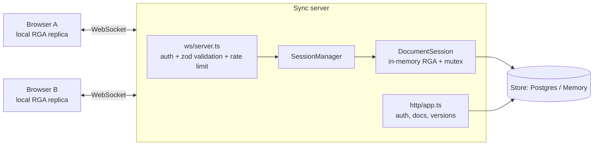

# Eventually Consistent — Backend

Backend for **Eventually Consistent**, a real-time collaborative plain-text editor. Replicas converge using an
**RGA sequence CRDT**; a Node.js WebSocket server routes operations, enforces access control, and persists an
append-only operation log plus periodic snapshots in PostgreSQL.

- **Stack:** Node 20+, TypeScript, Express (REST), `ws` (WebSocket), `zod` (validation), PostgreSQL (`pg`), Vitest.
- **Zero-setup mode:** leave `DATABASE_URL` empty and it runs on an in-memory store.

## Quick start

```bash
npm install
cp .env.example .env            # edit JWT_SECRET
# Option A: in-memory (no DB)
DATABASE_URL= npm run dev
# Option B: PostgreSQL via Docker
export JWT_SECRET=$(openssl rand -hex 32)
docker compose up --build       # API on http://localhost:4000
```

Scripts: `npm test` · `npm run lint` · `npm run typecheck` · `npm run build` · `npm run migrate`.
Set `TEST_DATABASE_URL` to also run the store contract tests against a real PostgreSQL.

## Architecture



| Layer               | Files                          | Responsibility                                                                                |
| ------------------- | ------------------------------ | --------------------------------------------------------------------------------------------- |
| CRDT (pure, no I/O) | `src/crdt/rga.ts`, `undo.ts`   | Merge rules, ordering, tombstones, snapshot (de)serialisation, per-user undo                  |
| Sessions            | `src/docs/*`                   | One live replica per open document, validate → persist → apply → broadcast, snapshots, replay |
| Transport           | `src/ws/*`                     | Upgrade auth, message schema, heartbeat, rate limiting, per-socket ordering                   |
| REST                | `src/http/*`                   | Register/login, documents, sharing, version history, restore                                  |
| Persistence         | `src/store/*`, `db/schema.sql` | `Store` interface with `PostgresStore` and `MemoryStore`                                      |

The CRDT has no dependency on the network, database or UI, so it is tested in isolation.

## CRDT data model (RGA)

- **Element id** `{ c, n }`: `c` = site id, `n` = Lamport counter (`max seen + 1`). Order: counter, then site id.
- **Insert** `{ type:"insert", id, ref, ch }` — one code point, placed right after `ref` (`null` = start).
- **Delete** `{ type:"delete", target }` — sets a tombstone; elements are never physically removed.
- **Concurrent inserts at the same position:** the higher id goes first; the integration step skips over
  higher-id siblings (and their subtrees). Typing runs are chains (`ref` = previous char), so concurrently typed
  words do not interleave.
- **Robust delivery:** `apply` is idempotent (duplicates ignored) and buffers ops whose `ref`/`target` has not
  arrived yet, so any order converges. Verified by a seeded property test (150 runs, 3 replicas, shuffled +
  duplicated delivery) in `tests/rga.test.ts`.
- **Cursors** are anchored to element ids (`{anchor, head}`); `Rga.cursorIndex(id)` maps them back to an index and
  keeps working when the anchored char is deleted (tombstones remain).

### Undo / redo (compensating ops)

The server keeps an undo/redo stack per `(document, user)`; one websocket `ops` batch = one undo step.
Undoing an insert deletes those characters (if still visible). Undoing a delete inserts a **new** character right
after the tombstone. Nobody else's edits are touched and no snapshot is restored.
Undo/redo ops are generated by the server (`siteId: "server"`) and broadcast to everyone like normal ops.

### Site ids and spoofing

A client's `siteId` must be `"<userId>~<anything>"`. Every op id the client sends must use that site id, so a user
cannot forge ids that collide with someone else's. Reusing the same `siteId` across reconnects is fine.

## WebSocket protocol

Connect to `ws://host:4000/ws?token=<JWT>` (a bad token gets HTTP 401 on upgrade). All messages are JSON.

Client → server

```jsonc
{ "type": "join", "docId": "<uuid>", "siteId": "<userId>~tab1", "since": 42 }   // since optional
{ "type": "ops", "msgId": "m1", "ops": [
  { "type": "insert", "id": { "c": "<userId>~tab1", "n": 7 }, "ref": { "c": "<userId>~tab1", "n": 6 }, "ch": "x" },
  { "type": "delete", "target": { "c": "<otherSite>", "n": 3 } } ] }
{ "type": "presence", "cursor": { "anchor": { "c": "...", "n": 7 }, "head": { "c": "...", "n": 7 } } }
{ "type": "undo" }   { "type": "redo" }   { "type": "ping" }
```

Server → client

```jsonc
{ "type": "joined", "siteId": "...", "role": "editor", "seq": 42, "collaborators": [ ... ] }
{ "type": "snapshot", "seq": 42, "state": { "v": 1, "clock": 9, "elements": [ ... ] } }  // fresh join
{ "type": "sync", "seq": 45, "ops": [ { "seq": 43, "siteId": "...", "op": { ... } } ] }   // join with `since`
{ "type": "ops", "seq": 46, "from": "<siteId>", "userId": "...", "ops": [ ... ] }       // remote edits
{ "type": "ack", "msgId": "m1", "seq": 46 }
{ "type": "presence", "siteId": "...", "userId": "...", "name": "Alice", "color": "#4363d8", "cursor": { ... } }
{ "type": "presence_leave", "siteId": "..." }   { "type": "meta", "title": "Renamed" }
{ "type": "error", "code": "missing_dependency", "message": "..." }                       // see below
```

Client flow: apply local edits to the local replica immediately → send `ops` → apply incoming `ops` with
`rga.apply`. On reconnect, rejoin with `since = lastSeqSeen`, and re-send any un-acked batches (duplicates are
harmless).

Error codes: `bad_message`, `bad_site`, `forbidden`, `missing_dependency` (client should rejoin without `since` to
get a fresh snapshot), `doc_too_large`, `not_joined`, `already_joined`, `internal`. Rate limit overrun closes the
socket with code `4429` (dropping ops silently would break convergence; the client reconnects and resyncs).
Presence is ephemeral: held in memory, never written to the operation log.

## REST API

All routes except `/health` and auth require `Authorization: Bearer <token>`.

| Method & path                                     | Role   | Purpose                                                                   |
| ------------------------------------------------- | ------ | ------------------------------------------------------------------------- |
| `POST /api/auth/register` `{name,email,password}` | —      | Create account, returns `{token,user}`                                    |
| `POST /api/auth/login` `{email,password}`         | —      | Returns `{token,user}`                                                    |
| `GET /api/docs` · `POST /api/docs` `{title}`      | any    | List my documents / create one (caller becomes owner)                     |
| `GET /api/docs/:id`                               | viewer | Metadata + current text + head `seq`                                      |
| `PATCH /api/docs/:id` `{title}`                   | editor | Rename (pushes a `meta` message to connected clients)                     |
| `POST /api/docs/:id/members` `{email,role}`       | owner  | Share as `editor` or `viewer`                                             |
| `GET /api/docs/:id/versions`                      | viewer | `{head, snapshots:[{seq,createdAt}]}`                                     |
| `GET /api/docs/:id/versions/:seq`                 | viewer | Text as of op `seq` (snapshot + replay)                                   |
| `GET /api/docs/:id/compare?from=&to=`             | viewer | Both texts + line diff (`to` defaults to head)                            |
| `POST /api/docs/:id/versions/:seq/restore`        | editor | Writes the old text back as **new** CRDT ops (history is never rewritten) |

Non-members get `404` (not `403`) so document ids are not discoverable.

## Database schema (`db/schema.sql`)

`users` · `documents` · `document_members(doc_id,user_id,role)` · `operations` · `snapshots`.

- `operations`: append-only; `seq BIGSERIAL` is the server's total order; `UNIQUE (doc_id, op_id)` with
  `ON CONFLICT DO NOTHING` makes retries/duplicate delivery idempotent. `op_id` is `i:<site>:<n>` / `d:<site>:<n>`.
- `snapshots`: full RGA state (including tombstones) at a `seq`; written every `SNAPSHOT_EVERY` ops and when the
  last client leaves a document.
- `seq` is increasing per document but not contiguous (the sequence is global); treat it as an opaque cursor.

**Write path:** validate batch against the replica (dry run) → one DB transaction appends the ops → apply to the
in-memory replica → broadcast → ack. If the DB write fails nothing was applied, so memory never gets ahead of disk.
Batches are atomic: one invalid op rejects the whole batch.

**Recovery / late join:** open = latest snapshot + replay of ops after it. A server restart is just a reopen.
New clients get a snapshot; reconnecting clients send `since` and get only the missed ops.

## Deployment

Needs a host that supports long-lived WebSocket connections (Fly.io, Render, Railway, a VM, ...).

- Set `DATABASE_URL`, `JWT_SECRET` (>= 32 chars, enforced when `NODE_ENV=production`), `CORS_ORIGIN`, `PORT`.
- The Docker image runs `node dist/index.js`; the schema is applied automatically on boot (idempotent).
- Terminate TLS at the platform/proxy so clients use `wss://`.
- Run a **single instance** (see limitations).

## Testing

`npm test` runs 44 tests (49 with `TEST_DATABASE_URL` set): RGA unit tests, the property-style convergence test, per-user undo, session logic
(idempotency, forged sites, viewer writes, size cap), recovery from snapshot + log, reconnect, time travel/restore,
and WebSocket/HTTP integration tests with concurrent clients. CI (`.github/workflows/ci.yml`) runs format check,
lint, typecheck, tests (with a PostgreSQL service) and build.

## Known limitations

- **Single server instance:** the server serialises writes per document in-process. Scaling out needs sticky
  routing per document or a pub/sub + sequencer.
- **Performance:** the element list is a plain array (O(n) insert/index lookup) with one element per character.
  Fine for documents of tens of thousands of characters; block-based/B-tree structures and run-length encoding are
  the next step. Tombstones are never garbage-collected.
- **Undo corner case:** if two users delete the same character and both undo, it is re-inserted twice.
- **History:** linear (no branching DAG); versions are addressed by op `seq` and snapshot marks.
- **Auth:** email + password with a 7-day JWT, no refresh/revocation/email verification; the token travels in the
  WebSocket URL query string (use `wss://`, and avoid logging URLs). Role changes apply on next join.
- **Plain text only:** no rich-text marks, comments, or offline multi-device merge.
- Rate limiting is per connection (WebSocket) and per IP (auth) and is in-memory.
